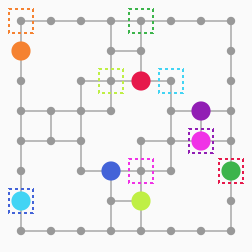
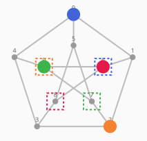
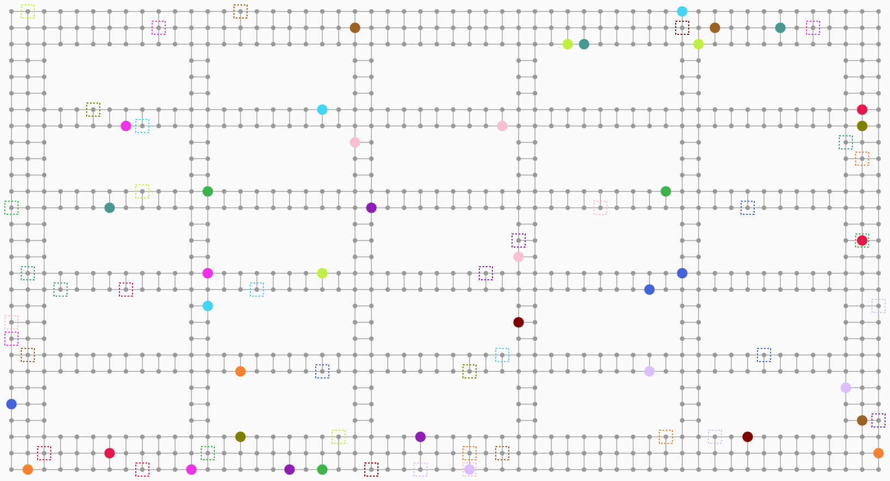

# MAPF

Multi-Agent Path Finding (MAPF) の学習・実験用プロジェクト。実行時の依存は **標準ライブラリのみ**(開発用に pytest / ruff)。

 

## 実装済みアルゴリズム

`python -m mapf --list-algos` で一覧が出ます。`-a 名前` で選び、`-o キー=値` でオプションを渡せます(例: `-a ecbs -o w=1.2`)。

| 名前 | 手法 | 完全性 | 解の質 | 向く規模 | 場所 |
|---|---|---|---|---|---|
| `astar` | 結合状態空間の A*(全探索) | あり | 最適 | 数台 | `joint_astar.py` |
| `cbs` | Conflict-Based Search (Sharon 2015) | あり | 最適 | 〜10台 | `cbs.py` |
| `id_cbs` | Independence Detection + CBS (Standley 2010) | あり | 最適 | 干渉が局所的なら〜20台 | `idcbs.py` |
| `ecbs` | Enhanced CBS (Barer 2014)。コスト ≤ `w` × 最適を保証 | あり | `w` 倍以内(`-o w=1.5`) | 数十台 | `ecbs.py` |
| `pp` | Prioritized Planning (Silver 2005) | なし | 良好 | 数十台〜 | `prioritized.py` |
| `pp_restarts` | PP のランダム再起動(優先順位を変えて最良を採用) | なし | PP より良い | 数十台〜 | `prioritized.py` |
| `whca` | WHCA* (Silver 2005)。窓つきの協調 A* | なし | 良好 | 数十台〜 | `whca.py` |
| `pibt` | PIBT (Okumura 2022) | なし | 粗い | 数百台 | `pibt.py` |
| `lacam` | LaCAM (Okumura 2023) | あり | 粗い(最初の解) | 数百台 | `lacam.py` |
| `lns` | MAPF-LNS (Li 2021)。PP の解を反復改善 | なし | 時間をかけるほど良い | 数十台〜 | `lns.py` |

- `astar`・`cbs`・`id_cbs` は sum-of-costs 最適です。3つのコストは、ランダムな小問題で一致することをテストで確認しています。
- `ecbs` は、解と一緒に最適コストの下界(`extra["lower_bound"]`)を返します。解のコストは `w` × 下界以内で、最適コストはその下界以上なので、最適との差を証明つきで知ることができます。
- 「完全」は、解が存在すれば時間をかけて見つかるという意味です。`cbs` / `id_cbs` / `ecbs` / `lacam` は、解が無い問題では探索上限か時間切れまで続きます。

共通部品: 時空間 A*(待機・頂点制約・辺制約・ゴール到達後の占有を考慮、`astar.py`)、衝突検出と解の検証(`validate.py`)、
MovingAI ベンチマーク形式の読み込み(`movingai.py`)、グリッド → グラフ JSON 変換(`convert.py`)、ASCII / アニメーション SVG 出力(`visualize.py`)、
全アルゴリズムの統一インターフェース(`algorithms.py` の `solve(名前, instance, timeout, seed, **options)`)。

## クイックスタート

```bash
make install                     # pip install -e '.[dev]'
make test                        # テスト
make demo ALGO=pibt AGENTS=10    # ランダムな問題を解いて ASCII で表示
make svg  ALGO=cbs  SEED=3       # out.svg にアニメーションを出力
make bench                       # 全アルゴリズムをランダム問題で比較
make bench-large                 # 40台の倉庫シナリオで全アルゴリズムを比較
make help                        # ターゲット一覧
```

CLI を直接使う場合:

```bash
python -m mapf maps/ring.json -a cbs --ascii
python -m mapf maps/petersen.json --svg out.svg
python -m mapf --random maps/room.json -n 8 --seed 3 -a lacam
python -m mapf maps/warehouse.json -a ecbs -o w=1.2 --svg out.svg
python -m mapf --movingai empty-8-8.map empty-8-8-random-1.scen -n 20 -a pibt
python -m mapf.bench --map maps/room.json -n 4 8 12 --trials 10 --timeout 2
python -m mapf.bench --scenario maps/warehouse.json --algos ecbs lns lacam
python -m mapf.convert maps/some.map out.json     # グリッド → グラフ JSON
```

終了コード: `0` 成功 / `1` 解なし(または探索上限) / `2` 解が検証に失敗。

## マップ(グラフ)と問題の JSON 形式

マップは **無向グラフ** です。エージェントは1ステップで「その場で待つ」か「辺を1本進む」かのどちらかを行います。
グリッドも、グリッドから作ったグラフとして扱います。

```json
{
  "graph": {
    "nodes": ["A", "B", {"id": "C", "pos": [2, 0]}, "D"],
    "edges": [["A", "B"], ["B", "C"], ["C", "D"], ["B", "D"]]
  },
  "agents": [
    {"start": "A", "goal": "D"},
    {"start": "D", "goal": "A"}
  ]
}
```

- `nodes`: ノード ID(整数または文字列)、または `{"id": ..., "pos": [x, y]}`。`pos` は描画専用の省略可能な座標で、無い場合は円形に配置します。全ノードに整数の `pos` があると、ASCII 表示は格子として描画します(ノードが無い位置は `#`)。
- `edges`: `[u, v]` の配列。無向で、重複した辺は1本にまとめます。自己ループと未定義ノードへの辺はエラーです。
- `agents`: 各エージェントの `start` と `goal`。始点どうし、終点どうしは重複不可です。
- マップだけのファイル(`{"nodes": ..., "edges": ...}` または `{"graph": ...}`)も `--random` と `mapf.bench` に渡せます。

`maps/` のサンプル: `crossing.json`、`corridor.json`(グリッド)、`ring.json`(文字列 ID、座標なし)、`petersen.json`(ペテルセングラフ)、`room.json`(8x8 の部屋、マップのみ)、`warehouse.json`(54x29 の倉庫、966ノード、**40エージェント**)。
MovingAI の `.map` / `.scen` はそのまま読み込めて、グリッドは4近傍のグラフになります(ノード ID は空きマスの行優先の通し番号、`pos = [列, 行]`)。`.` `G` `S` が通行可、それ以外は障害物です。

Python から使う場合:

```python
from mapf import Graph, Instance, cbs

graph = Graph(["A", "B", "C"], [("A", "B"), ("B", "C")])
sol = cbs(Instance(graph, ("A",), ("C",)))
print(sol.paths)  # [['A', 'B', 'C']]
```

## 問題設定

全エージェントが同時に移動。頂点衝突と交換(スワップ)衝突を禁止。ゴール到達後もそのノードに留まり、他のエージェントを塞ぎ続けます。目的関数は sum-of-costs(各エージェントが最終的にゴールに着く時刻の合計)と makespan。

## ベンチマーク例

### 40エージェントの倉庫(`maps/warehouse.json`、966ノード)

`make bench-large`(時間制限10秒)。

| algo | sum of costs | makespan | time [s] |
|---|---:|---:|---:|
| cbs | 時間切れ | - | - |
| id_cbs | 時間切れ | - | - |
| ecbs (w=1.5) | **1284** | 71 | 0.31 |
| lns (1秒) | 1287 | 71 | 1.00 |
| pp_restarts | 1297 | 71 | 2.12 |
| pp | 1384 | 71 | 0.18 |
| whca | 1397 | 71 | 0.07 |
| lacam | 1483 | 71 | 0.03 |
| pibt | 1494 | 71 | 0.03 |

ECBS は 0.3 秒で、最適コストの 1.014 倍以内と証明つきの解を返しました(下界 1266)。PIBT / LaCAM は最速ですが、コストは最良より約16%大きくなりました。



### 小さな部屋(`maps/room.json`、8x8)

各10問、時間制限2秒。コスト・時間は全手法が解けた問題の平均(`*` は全手法が解けた問題が無く、その手法が解けた問題の平均)。

| agents | algo | solved | avg SoC | avg makespan | avg time [s] |
|---:|---|---:|---:|---:|---:|
| 8 | cbs | 9/10 | 48.4 | 10.7 | 0.2425 |
| 8 | id_cbs | 9/10 | 48.4 | 10.7 | 0.3696 |
| 8 | ecbs | 10/10 | 49.9 | 11.3 | 0.0028 |
| 8 | pp | 10/10 | 58.3 | 12.1 | 0.0007 |
| 8 | pp_restarts | 10/10 | 49.4 | 11.8 | 0.0573 |
| 8 | whca | 10/10 | 59.0 | 11.3 | 0.0014 |
| 8 | pibt | 9/10 | 68.9 | 14.3 | 0.0005 |
| 8 | lacam | 10/10 | 68.3 | 14.0 | 0.0007 |
| 8 | lns | 10/10 | 48.4 | 10.9 | 1.0019 |
| 12 | cbs | 1/10 | 54.0* | 6.0* | 0.0079* |
| 12 | id_cbs | 2/10 | 71.0* | 9.0* | 0.3441* |
| 12 | ecbs | 10/10 | 92.9* | 13.6* | 0.0317* |
| 12 | pp | 6/10 | 93.8* | 11.2* | 0.0011* |
| 12 | pp_restarts | 10/10 | 86.4* | 12.7* | 0.0752* |
| 12 | whca | 8/10 | 99.6* | 11.4* | 0.0028* |
| 12 | pibt | 3/10 | 137.3* | 18.7* | 0.0008* |
| 12 | lacam | 10/10 | 175.8* | 24.6* | 0.0078* |
| 12 | lns | 10/10 | 84.0* | 12.3* | 1.0013* |

読み取れること:
- 8台までなら CBS 系が最適解を出せるが、12台では時間切れが増える(`solved` 欄)。
- ECBS は 12台でも全問解け、コストは PP より小さい。LNS と PP の再起動は、時間をかけるほど質が上がる。
- PIBT は行き止まりのある狭い地図で失敗しやすく(12台で3/10)、LaCAM は完全なので全問解けるが、解は粗い。
- 12台の行の `*` 付きの数値は、手法ごとに母数が違うため、手法間の比較には使えない(解けた数と時間の傾向だけ見てください)。

## 開発

```bash
make check    # ruff + pytest(CI と同じ)
make fmt      # 自動整形
make cov      # カバレッジ
```

GitHub Actions(`.github/workflows/ci.yml`)で Python 3.10 / 3.12 / 3.13 の lint とテストを実行します。

## 今後の候補

EECBS、衝突の cardinal 分類(ICBS)による CBS 高速化、LaCAM\*(解の改善)、Push and Swap、Lifelong MAPF、実行遅延に強い計画(Robust MAPF)、8近傍移動、有向グラフ・重み付き辺。
